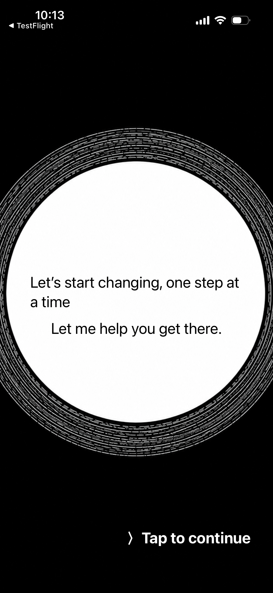
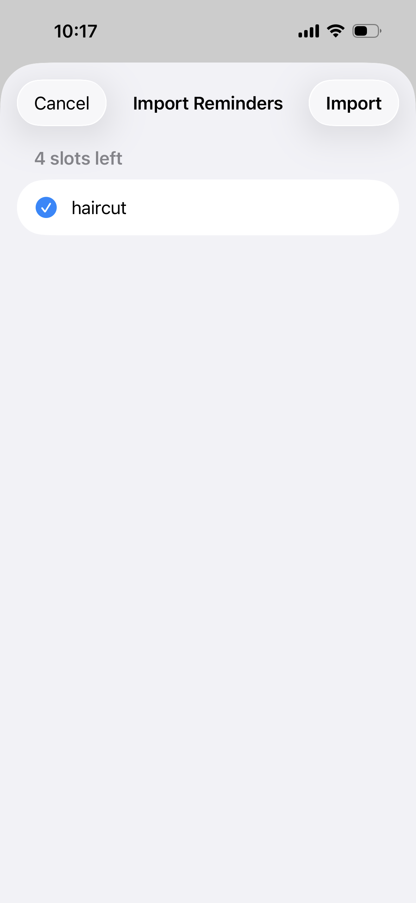
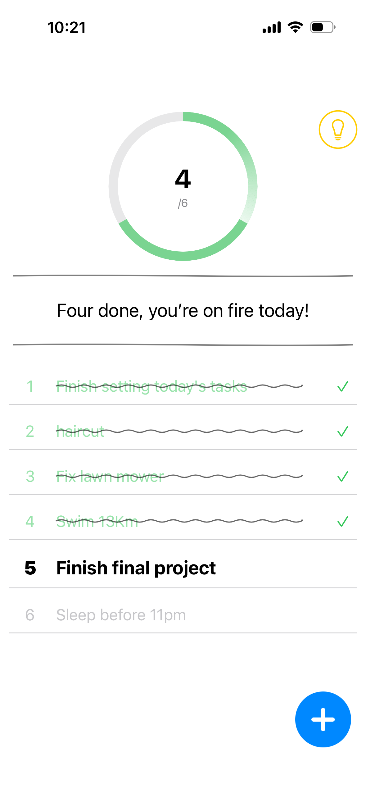
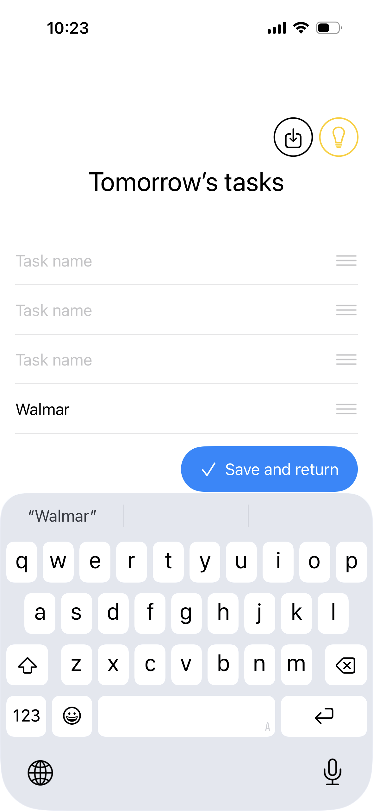

# SixThings：每天六件事

> 以「艾維・李時間管理法」為基礎的每日任務 App：每天只寫下六件事，依重要程度排序，由上往下逐一完成。


<p align="center">
  
  
  
  
</p>

---

## 功能

- 每日六件事清單，搭配進度圓環
- 今日 / 明日任務編輯：鎖定區＋可編輯區、拖曳排序
- 未完成任務自動移到隔天
- **從 iPhone「提醒事項」匯入**今天或明天到期的項目
- 每日提醒通知（本地通知，可開關）
- 首次使用教學、App 內切換語言（繁體中文 / English）
- 橫幅廣告與完整的隱私權同意流程（GDPR、App Tracking Transparency）

## 技術

| 類別 | 使用技術 |
|---|---|
| 語言 / UI | Swift、SwiftUI |
| 架構 | MVVM |
| 資料 | UserDefaults + Codable |
| 系統框架 | EventKit（提醒事項）、UserNotifications、AppTrackingTransparency |
| 第三方 SDK | Google Mobile Ads SDK（AdMob）、Google User Messaging Platform（UMP） |
| 併發 | async/await、`withCheckedContinuation`、`@MainActor` |
| 在地化 | String Catalog（App 介面 + Info.plist 權限說明） |
| 最低版本 | iOS 17 |

## 專案結構

```
SixThings/
├── Models/        # Task、ReminderItem
├── ViewModels/    # TaskViewModel
├── Services/      # RemindersService（EventKit）、AdsConsentManager（UMP + AdMob）
├── Views/         # 主畫面、編輯頁、匯入表單、設定頁、廣告橫幅
└── Extensions/    # String+Extensions（空白判斷、加權字數）
```

## 上架與隱私權合規

- App Store 上架流程：簽署、TestFlight、App 隱私權標籤、年齡分級
- 依照 Xcode Privacy Report 填寫 App 隱私權問卷
- Google UMP 處理歐洲經濟區 / 英國的 GDPR 同意，以及 ATT 之前的 IDFA 說明
- [隱私權政策](https://minrayc.github.io/privacy.html)

📧 minrayc@gmail.com
